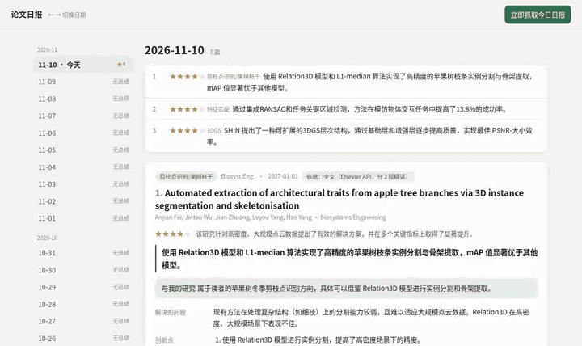
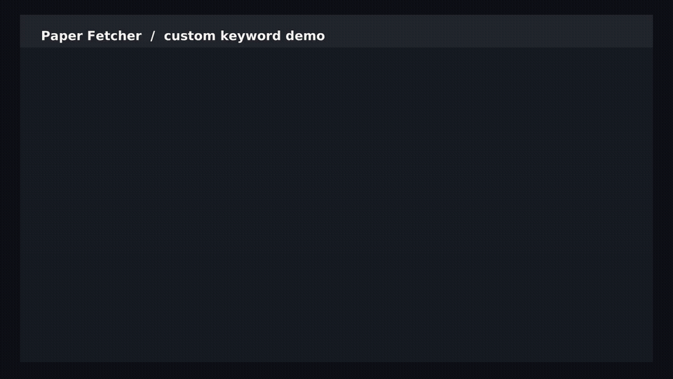
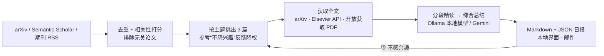

# Paper Fetcher

每天自动从 arXiv、Semantic Scholar 和农业/机器人期刊中挑出**与你研究方向最相关的 3 篇论文**，读完全文后生成结构化的中文总结：一句话结论、与我的研究的关系、创新点、方法、实验、结果、消融、局限、代码链接，以及 1–5 星推荐度。附带一个本地网页界面，用来浏览日报和一键标记“不感兴趣”，标记会影响之后的选文排序。

## 演示

[](assets/ui-demo.mp4)

> 本地界面：先看速览，再读完整总结；标记“不感兴趣”；用 ← → 键切换日期。点击动图可查看 [MP4](assets/ui-demo.mp4)。

<details>
<summary>命令行演示：自定义关键词检索</summary>

[](assets/demo.mp4)

</details>

## 工作流程



1. **检索**：每个研究主题有一组 arXiv 检索式和关键词，期刊 RSS 按关键词归类。
2. **筛选**：标题命中关键词 +2 分，摘要命中 +1 分，分数不够的不进日报。期刊来源只在分数接近时略微加分，没有摘要的条目会降权。
3. **选文**：每个主题最多选 1 篇，取分数最高的 3 篇。时间窗口从近 3 天开始，不够 3 篇时扩大到 7 天、30 天。
4. **读全文**：依次尝试 arXiv HTML → arXiv PDF → Elsevier API → 开放获取 PDF；都拿不到时退回摘要。
5. **总结**：长论文切成多段，逐段提取要点，再综合成一份固定字段的 JSON 总结。原文中不存在的链接会被自动删除。

## 日报内容

每份日报开头是一张**速览表**（推荐度 + 一句话），30 秒内就能决定先读哪篇。论文按推荐度从高到低排列，每篇包含：

| 字段 | 内容 |
|---|---|
| 推荐度 | 1–5 星，按对你研究方向的价值打分，附理由 |
| 一句话 | 用什么方法解决了什么问题，以及最关键的一个数字 |
| 与我的研究 | 属于你的哪个方向，具体可以借鉴哪个模块或思路 |
| 解决的问题 / 创新点 / 方法 | 现有方法的不足；3–5 条具体的技术创新；从输入、各模块到输出的流程 |
| 实验设置 / 主要结果 / 消融 | 数据集、基线、指标；2–4 个具体数字；各模块的贡献 |
| 局限 / 代码数据 | 原文承认的不足或实验上的短板；代码、数据是否公开及链接 |
| 总结依据 | 全文（来源、分几段精读）/ 摘要 / 仅标题 |

只有标题可用时，只给出推荐度和一句话判断，不展示方法和结果，避免模型猜测。

## 快速开始

要求 Python 3.10+。

```bash
git clone https://github.com/Anqi00/paper-fetcher.git
cd paper-fetcher
python3 -m venv .venv
.venv/bin/pip install -r requirements.txt

# 预览会选出哪些论文（不写文件、不调用模型、不更新缓存）
.venv/bin/python fetcher.py --no-s2 --dry-run
```

开启中文总结（以本地 Ollama 为例，模型约 4.7GB，8GB 显存可用）：

```bash
ollama pull qwen2.5:7b
cp .env.example .env            # 编辑 .env：SUMMARY_BACKEND=ollama
.venv/bin/python fetcher.py     # 生成 output/YYYY-MM-DD.md 和 .json
.venv/bin/python ui.py          # 打开本地界面
```

`config.py` 启动时会自动读取项目根目录下的 `.env`，cron 中同样生效；已存在的环境变量优先。

## 配置研究方向

都在 [`config.py`](config.py) 中：

- `RESEARCH_PROFILE`：写进总结提示词的研究方向，模型据此判断“与我的研究”和推荐度
- `TOPICS`：每个主题包含
  - `arxiv_queries`：arXiv 检索式，支持 `abs:"短语"`、`OR`、`AND`；不带语法的普通词之间按 AND 连接
  - `s2_queries`：Semantic Scholar 检索词
  - `keywords`：相关性打分与 RSS 归类用的小写子串
- `EXCLUDE_KEYWORDS`：命中即排除，例如 `surgical`、`medical image`
- `MIN_RELEVANCE`、`RELEVANCE_CAP`：入选门槛与打分上限
- `MAX_PAPERS_TOTAL`：每天推送几篇（默认 3）
- `LOOKBACK_STEPS`：时间窗口逐步扩大的天数
- `RSS_JOURNALS`、`S2_TARGET_VENUES`：期刊 RSS 与会议/期刊白名单

默认配置的方向是：苹果树冬季剪枝点识别、特征匹配、2D-3D 匹配/视觉定位、3DGS、4DGS。

## 总结后端与全文获取

在 `.env` 中设置（完整选项见 [`.env.example`](.env.example)）：

| 变量 | 说明 |
|---|---|
| `SUMMARY_BACKEND` | `none`（默认，不总结）/ `ollama` / `gemini` |
| `OLLAMA_MODEL`、`OLLAMA_NUM_CTX` | 本地模型与上下文窗口，默认 `qwen2.5:7b`、`12288` |
| `GEMINI_API_KEY`、`GEMINI_MODEL` | Gemini 后端；上下文长，整篇一次读完，总结质量更好 |
| `SUMMARY_USE_FULLTEXT` | `1` 读全文（默认），`0` 只用摘要 |
| `FULLTEXT_CHUNK_CHARS`、`FULLTEXT_MAX_CHUNKS` | 分段精读：每段字符数（默认 20000），最多几段（默认 6） |
| `ELSEVIER_API_KEY` | 可选，用于 ScienceDirect 期刊的全文，见下文 |
| `S2_API_KEY` | 可选，Semantic Scholar key；没有时容易被限流 |

使用本地 7B 模型时，每篇约 1–2 分钟，3 篇约 5 分钟。

**全文来源：**

| 论文类型 | 获取方式 |
|---|---|
| arXiv 论文 | arXiv HTML 全文；失败时读 PDF（需要 `pypdf`） |
| 有 arXiv 版本的期刊/会议论文 | 用 Crossref 按标题补 DOI，再通过 Semantic Scholar / OpenAlex 找到 arXiv 版本 |
| 开放获取论文 | OpenAlex / Semantic Scholar 提供的开放获取 PDF |
| ScienceDirect 期刊（COMPAG、Biosystems Engineering、Smart Agricultural Technology 等） | Elsevier Article Retrieval API |

ScienceDirect 的网页和 PDF 会拦截脚本下载，因此需要在 [dev.elsevier.com](https://dev.elsevier.com) 免费申请 API key，填入 `ELSEVIER_API_KEY`：

- 开放获取论文：直接返回全文
- 订阅论文：请求来自订阅了该期刊的机构网络（校园网或学校 VPN）时返回全文，否则只有元数据或摘要

## 本地界面

```bash
.venv/bin/python ui.py                 # 自动打开 http://127.0.0.1:8765
.venv/bin/python ui.py --port 9000 --no-browser
```

- 左侧按日期浏览（← → 键切换），★ 后的数字是当天最高推荐度
- 顶部速览表点击后跳到对应论文的完整总结
- **👎 不感兴趣**：一键写入 `output/disliked.txt`，再点一次撤销
- 旧日报没有总结时，点“生成总结”补上；“立即抓取今日日报”在后台运行抓取，并实时显示日志

界面只监听本机 `127.0.0.1`，只用 Python 标准库，不需要额外依赖。

## “不感兴趣”反馈

所有标记保存在 `output/disliked.txt`，每行格式为“日报日期 论文序号”。可以在界面里点按钮，也可以手动编辑：

```text
# 不想看的论文：每行填写“日报日期 论文序号”
2026-07-24 2
2026-07-30 1
```

每次抓取时，程序会根据这些论文的标题、摘要和主题建立一个“不感兴趣”画像，与之相似的候选论文会被降权。`config.py` 中的 `FEEDBACK_WEIGHT` 控制降权强度，设为 `0` 即关闭。无法识别的行会在终端提示，重复的行只算一次。

## 每日自动运行

```bash
chmod +x install_cron.sh
./install_cron.sh        # 每天 08:00 运行，优先使用 .venv 中的 Python
```

- 日志写在 `output/cron.log`
- 运行时电脑需要开机；如果依赖学校订阅获取全文，还需要连着校园网或学校 VPN
- 设置了 `EMAIL_TO` 等变量时，日报会同时通过 SMTP 发送

## 命令行参数

| 参数 | 作用 |
|---|---|
| `--dry-run` | 只预览选文，不写文件、不总结、不更新缓存 |
| `--no-s2` / `--no-rss` | 跳过 Semantic Scholar / 期刊 RSS |
| `--no-cache` | 忽略已读缓存（默认不会重复推送同一篇） |
| `--max-papers N` | 本次输出篇数 |
| `--query "..." --label "..."` | 临时自定义检索词（可重复使用），替代 `config.py` 中的主题 |
| `--resummarize YYYY-MM-DD` | 不抓取新论文，只为已有日报重新生成总结（保持原顺序） |
| `--output-dir PATH` | 输出目录（默认 `output/`） |

## 数据源

本项目不提供代理服务，直接调用公开接口，请遵守各自的使用条款：

- [arXiv API](https://info.arxiv.org/help/api/user-manual.html)：无需 key，请求之间间隔 3 秒以上
- [Semantic Scholar Graph API](https://api.semanticscholar.org/api-docs/graph)：可以不用 key，但推荐[申请](https://www.semanticscholar.org/product/api)；连续被限流时，本次运行会自动跳过其余 S2 查询
- [OpenAlex](https://openalex.org)、[Crossref](https://www.crossref.org/documentation/retrieve-metadata/rest-api/)：用于补全摘要、DOI 和开放获取链接
- [Elsevier APIs](https://dev.elsevier.com)：可选，用于 ScienceDirect 期刊全文
- 期刊 RSS：地址在 `config.py` 的 `RSS_JOURNALS` 中，用 `feedparser` 解析

## 测试

```bash
.venv/bin/python -m unittest discover -s tests -v
```

## 输出与隐私

- 日报、缓存、日志、`disliked.txt`、`.env`、`.venv` 都已加入 `.gitignore`，不会被提交
- API key 和邮箱密码只放在 `.env` 或环境变量中，不要写进 `config.py`
- 使用 Ollama 时，论文内容只在本机处理；使用 Gemini 时，论文内容会发送给 Google

## License

[MIT](LICENSE)
